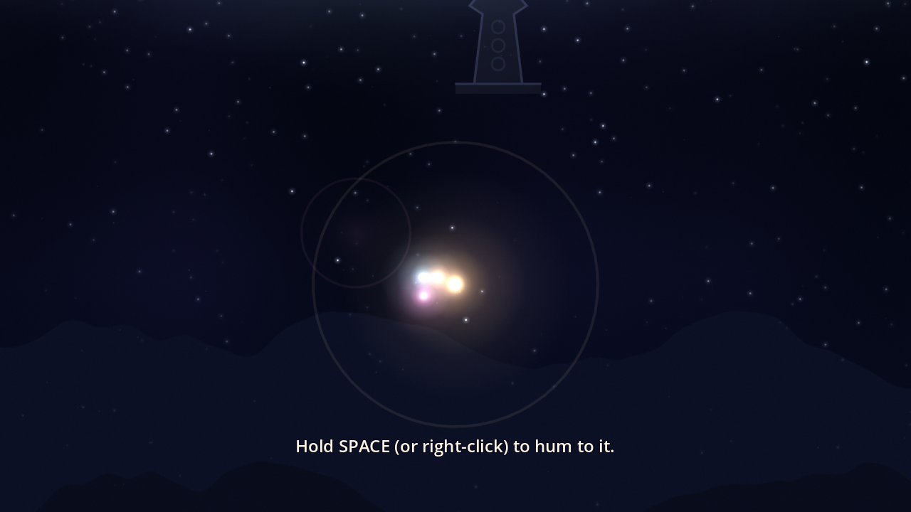

# Kindred Lights

*A small light, a long night.*

A gentle game about not crossing the cold alone, made solo for
[thatgamejam #02](https://itch.io/jam/thatgamejam02) (theme: a piece of music by Jason Grace).



You are a small warm light on a cold night. Hum to the lost lights you find and they follow you
as a glowing trail. Four old lanterns stand up the mountain. Each one needs more friends beside
you before it will burn again, and each one you light melts the frost wall above it, warms the sky
and adds a voice to the music. Cold mist drains your light, but every friend you carry keeps you
warmer. Light the last lantern and you all rise into the dawn together.

## How the music shaped it

The theme track is in F minor at about 80 bpm. It starts as a quiet, lonely line and around the
20 second mark it opens up into something fuller and warmer, then it lets go. The game follows the
same arc:

- **Alone to together.** You start as one light. The game's own score is a layered loop in the
  same key and tempo (F minor, i-VI-III-VII, 80 bpm). It starts as a single drone, and each lantern
  you light fades in another layer (pad, arpeggio, bells), so the music grows with your group.
- **Everything breathes at 80 bpm.** Lights pulse on the beat and the hum ring ripples on it.
- **The ending is the theme.** When the last lantern is lit the game's music falls away and the
  theme track plays, unmodified, while you rise from night to dawn with everyone you gathered.
- **Contrast and transformation.** The palette moves from cold blue night through warm dusk to
  dawn, one step per lantern.

## Controls

| Action | Keyboard / mouse | Gamepad |
| --- | --- | --- |
| Drift | WASD / arrow keys, or hold left mouse button | Left stick |
| Hum (slows you, calls lights, lights lanterns) | Space (also Shift, Z, J) or right mouse button | A / Cross |
| Pause | Esc or P | Start |
| Fullscreen | F | |

Some lights are shy: approach them slowly while humming. The wind currents push you; humming
holds you steady. If the cold puts your light out, your friends drift back home and you can gather
them again. You can't lose. Takes about 5 to 10 minutes.

## Build

Made with Godot 4.3 (GL Compatibility renderer), exported to Windows, macOS (universal),
Linux and Web from Linux using the official export templates.

```
cd game
godot --headless --editor --quit                 # import
godot --headless --export-release "Windows Desktop"
godot --headless --export-release "macOS"
godot --headless --export-release "Web"
```

The theme track is not in this repository (it belongs to its composer and may only be used inside
jam entries). To build the full ending, put the jam's theme recording at
`game/audio/theme_jason_grace.ogg`.

## Assets and credits

- **Code, visuals:** everything you see is drawn in code (`main.gd`, `sky.gdshader`), with no
  image assets apart from the generated icon.
- **Music and sound effects:** synthesized by `tools/gen_audio.py` (numpy additive synthesis), made
  for this game.
- **Ending music:** the thatgamejam #02 theme, composed by **Jason Grace**, used unmodified and only
  in this jam entry.
- **Engine:** [Godot Engine](https://godotengine.org) 4.3 (MIT).
- **Font:** Godot's default font.

## AI use disclosure

**This game contains AI-generated content.** It was built by Hark, an AI agent, working for
Abdul AmberNeel. AI wrote the game design, the level layout, all GDScript and shader code, the
on-screen text, and `tools/gen_audio.py`, the script that synthesizes the game's own music and
sound effects. No image, music or voice generation models were used: all visuals are drawn by that
code at runtime, and all sound apart from the theme comes from that script. The theme track was
composed by a human (Jason Grace) and is used unmodified.

## License

Code and generated audio: MIT (see `LICENSE`). The theme track is not covered.
